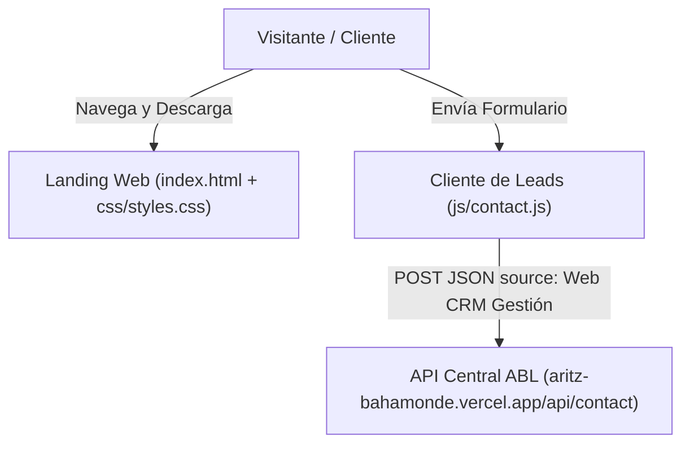

# ARQUITECTURA DEL SISTEMA Y DIAGRAMA C4

## 1. VISTA DE CONTEXTO (NIVEL 1 C4)
El sistema **Web CRM Gestión** es la landing page comercial de alta conversión desplegada en Vercel para distribución del instalador oficial Windows (`CRM-Gestión-v1.0.26-Setup.exe`) y captura de leads.

## 2. VISTA DE MÓDULOS (< 300 LÍNEAS POR ARCHIVO)
- **Estructura Semántica (`index.html`):** Maquetación accesible con activos `.avif` optimizados y atributos `width`/`height` explícitos.
- **Estilos (`css/styles.css`):** Variables CSS, gradientes, animaciones y utilidades glassmorphism.
- **Interacciones (`js/ui.js`):** Gestión de cookies, menú móvil, lightbox de capturas y modales legales.
- **Captura de Leads (`js/contact.js`):** Envío único con debounce hacia el endpoint centralizado de contacto.
